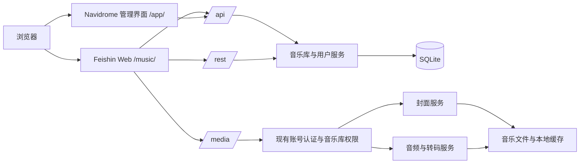

# 开发架构

## 交付范围

当前版本由 Navidrome v0.64.2 后端、Navidrome 管理界面和 Feishin v1.17.0 Web 前端组成，提供本站登录、音乐库浏览、个人队列、播放、歌词、收藏、统一封面引用和版本化媒体路径。页面、数据接口和媒体入口由同一个 Go 进程提供。

| 开发目标 | 当前实现 |
|---|---|
| 复用开源项目 | Navidrome 负责音乐库与媒体服务，Feishin Web 负责音乐站交互，两套源码在同一 Git 仓库维护 |
| 现代前端 | 接入 Feishin 的 Web 播放器、专辑和歌手页面、队列、歌词及已有多歌手展示 |
| 媒体路径与缓存 | `/media/` 路径明确资源与输出规格，后端提供媒体版本、私有缓存、条件请求和 Range 播放 |
| `al-`、`mf-` 统一 | 后端返回 `coverArtId`，相同图片内容使用专辑封面地址，独立曲目封面保留自身地址 |
| 外部元数据获取 | 本项目配置使用本地标签和已保存信息，外部集成由 `EnableExternalServices = false` 统一关闭 |

ServerMan 账号绑定、边缘鉴权与共享 CDN 缓存、元数据覆写与一键匹配、评论、一起听、离线音乐继续按[分阶段待办](todo.md)推进。

## 运行结构



后端使用 Go、chi 和 SQLite，音频读取与 FFmpeg 转码沿用 Navidrome。前端使用 React、TypeScript、Mantine、React Query 和 Zustand，保留 Feishin 的数据适配、播放器和页面组织。

| 入口 | 职责 | 主要实现 |
|---|---|---|
| `/` | 跳转音乐站 | `backend/server/server.go` |
| `/music/` | 音乐站与静态资源 | `backend/server/music_ui.go` |
| `/app/` | 创建管理员、用户与音乐库管理 | Navidrome 原有界面与 `server/serve_index.go` |
| `/auth/` | 创建初始管理员、本站登录 | `backend/server/auth.go` |
| `/api/` | 曲目、专辑、歌手、歌单和管理数据 | `backend/server/nativeapi/` |
| `/rest/` | Subsonic 浏览、收藏、播放记录和兼容播放 | `backend/server/subsonic/` |
| `/media/` | 本站封面与基本音频播放 | `backend/server/subsonic/media.go` |

`BaseURL` 中的站点前缀应用于以上入口。以前缀 `/radio` 部署时，音乐站位于 `/radio/music/`，运行配置中的服务地址为当前来源加 `/radio`。

## 页面加载与本站配置

Feishin 的 Web 构建输出到 `backend/resources/music/`，由 `backend/resources/embed.go` 嵌入后端。管理界面构建到 `backend/ui/build/`，由 `backend/ui/embed.go` 嵌入。用户部署音乐站时运行同一个后端程序。

音乐站使用 HashRouter，例如 `/music/#/library/albums`、`/music/#/library/songs` 和 `/music/#/now-playing`。页面路由在浏览器内切换，服务端提供 `/music/` 的静态页面。

页面先加载 `/music/settings.js`。服务端生成以下配置：

| 配置 | 值与含义 |
|---|---|
| `SERVER_NAME` | `ndFork`，本站名称 |
| `SERVER_TYPE` | `navidrome`，选择 Navidrome 数据适配 |
| `SERVER_URL` | 浏览器当前来源加站点前缀 |
| `SERVER_LOCK` | `true`，登录页使用本站服务 |
| `ANALYTICS_DISABLED` | `true`，音乐站使用本地运行配置 |

运行配置与入口页面随访问更新。带构建版本的 JS、CSS 等资源按文件名长期缓存。PWA 清单和 Service Worker 位于 `/music/`，安装入口为相对地址 `./`，作用范围覆盖音乐站。当前 PWA 缓存应用资源，离线音频下载与 OPFS 管理见第六阶段。

## 登录与数据访问

首次使用在管理界面创建管理员。音乐站通过 `POST /auth/login` 提交 `username`、`password`，沿用 Navidrome 的认证响应。

| 前端凭据 | 来源 | 请求形式 |
|---|---|---|
| `ndCredential` | 登录响应中的 `token` | 原生接口请求头 `x-nd-authorization: Bearer …` |
| `credential` | 登录响应中的 `subsonicSalt`、`subsonicToken` | `u={用户名}&s={salt}&t={token}` 查询参数 |

`/media/` 复用 Subsonic 的参数处理与认证，使用同一账号及音乐库访问权限。前端封面地址附带 `v=1.16.1&c=ndFork`；音频地址继承播放服务的协议版本与客户端参数。兼容客户端继续使用既有凭据形式。

音乐库查询沿用 Navidrome 的用户上下文和数据库过滤。媒体认证仍由源站处理；后续的中心身份与边缘授权在相同资源路径上接入。

## 前端数据与播放流程

页面通过现有 `api.controller` 调用 Navidrome 适配层，React Query 管理数据查询与更新，播放器和用户设置使用现有 Zustand 状态。

曲目列表和详情使用 `/api/song`、`/api/song/{id}`；专辑和歌手使用 `/api/album`、`/api/artist`；收藏、取消收藏和播放记录继续使用 `/rest/star`、`/rest/unstar`、`/rest/scrobble` 等兼容接口。列表沿用 `_start`、`_end`、`_sort`、`_order` 等查询参数。

`navidrome-normalize.ts` 将后端数据转换为 Feishin 的曲目、专辑与歌手模型。多歌手读取 `participants` 中的 `artist`、`albumartist` 及其他角色，保留每位歌手的 ID 与名称，供列表、详情和播放器使用。

播放时，`use-stream-url.tsx` 传递曲目 ID、`updatedAt` 和音质设置。Navidrome 适配层先调用已有 Subsonic 播放决策，再将普通 `/rest/stream.view` 地址转换为本站媒体路径。原始音频使用 `raw/0/0`；格式为 `aac`、`mp3`、`opus` 的基本播放进入对应路径。OpenSubsonic 转码决策生成的 `/rest/getTranscodeStream.view` 继续承担专用转码播放。

## 封面数据结构与统一规则

封面继续采用 Navidrome 已有的图片内容版本。图片内容相同意味着已有内容标识相同，比较在读取结果上完成。

| 数据 | 作用 |
|---|---|
| `artwork` | 保存图片内容标识、类型、尺寸及大小等图片信息 |
| `item_artwork` | 通过对象类型、对象 ID、图片类型关联图片，保存来源与更新时间 |
| `MediaFile.ItemImage` | 曲目实际封面的内容标识与显示信息 |
| `MediaFile.AlbumImage` | 所属专辑封面的内容标识与显示信息 |
| 原生接口 `coverArtId` | 后端确定的曲目封面引用，供前端直接生成地址 |

曲目读取时，`artwork_hydration.go` 批量加载曲目与专辑的图片信息，再通过 `MediaFile.CoverArtID()` 确定引用：

1. 曲目与专辑的非空图片内容标识相同，返回 `al-{专辑ID}_{图片版本}`。
2. 独立曲目封面使用 `mf-{曲目ID}_{图片版本}`。
3. 继承专辑封面的曲目使用专辑引用；分碟封面继续按 Navidrome 的 `dc-` 规则选择。
4. 图片仍在处理时，引用保留对象身份；处理完成后，数据接口返回已确认的图片版本。

`coverArtId` 是读取时生成的字段，使用 `structs:"-"` 排除数据库写入。曲目列表、详情、歌单曲目和经过图片信息加载的队列共用该字段。Subsonic 响应通过同一个 `CoverArtID()` 方法生成 `coverArt`，前端归一化直接读取原生接口的 `coverArtId`。

同一张专辑的页面、曲目行和播放栏，在使用相同图片、尺寸和裁剪方式时，请求同一个 `al-` 地址。独立曲目封面继续展示自己的图片。已有 `/media/cover/mf-…` 请求在图片内容与专辑一致时返回 `307`，`Location` 指向同规格的 `al-` 地址，并保留认证查询参数。别名响应采用 `no-store`，后续访问根据最新封面关联确定地址。

封面原始图片和缩放图片继续复用 Navidrome 的图片服务。缩放缓存键由图片内容、尺寸、裁剪和编码设置组成，相同图片可复用源站处理结果。

## 媒体接口约定

### 封面

```text
GET | HEAD /media/cover/{封面标识}/{尺寸}/{裁剪方式}
```

封面标识包括 `al-`、`mf-`、`ar-`、`pl-`、`ra-`、`dc-`；已确认的图片版本以 `_` 连接在标识末尾。尺寸范围为 `0` 至 `2048`，`0` 表示原始尺寸，`fit` 保持比例，`square` 表示方形裁剪。

例如，以下路径同时用于专辑页与继承该封面的曲目：

```text
/media/cover/al-AlbumID_0123456789abcdef/300/fit?u=…&s=…&t=…&v=1.16.1&c=ndFork
```

后端先验证账号，再读取图片。带版本请求与当前图片版本一致时长期缓存；版本已更新时返回 `410`，新版本地址来自数据接口。临时占位图采用 `no-store`。封面响应提供已有 `ETag` 和 `Last-Modified`，匹配 `If-None-Match` 时返回 `304`。

### 音频

```text
GET | HEAD /media/stream/{曲目ID}/{文件更新时间}/{格式}/{码率}/{起始秒数}
```

| 参数 | 约定 |
|---|---|
| 曲目 ID | Navidrome 曲目 ID |
| 文件更新时间 | 原生接口的 `updatedAt`，保持 RFC3339 小数秒与时区，按路径编码 |
| 格式 | `raw`、`mp3`、`opus`、`aac`；服务端接受 `auto` 交由已有转码决策选择 |
| 码率 | 非负整数，沿用 Navidrome 的 kbps 约定 |
| 起始秒数 | 非负整数，表示服务端输出的起始位置 |

原始音频示例：

```text
/media/stream/TrackID/2026-11-07T10%3A20%3A30.1234567%2B08%3A00/raw/0/0?u=…&s=…&t=…&v=1.13.0&c=Feishin
```

前端从路径中明确曲目版本与音质，移除普通流地址中的 `id`、`format`、`maxBitRate` 和随机 `_` 查询参数。媒体凭据保留在查询串中。

服务端比较文件版本后，复用 `ResolveRequest` 和 `MediaStreamer.NewStream`。可定位的原始音频由 `http.ServeContent` 处理 Range 与条件请求，区间读取返回 `206` 和 `Content-Range`。转码继续采用现有转码配置、播放器设置与缓存。

## 缓存约定

默认通过 `NoStore` 中间件设置即时响应，媒体和静态资源在取得明确内容后设置对应缓存策略。

| 响应 | `Cache-Control` | 更新方式 |
|---|---|---|
| `/auth/`、`/api/` 的动态数据 | `no-store` | 每次读取当前用户状态 |
| `/rest/` 的动态与写操作 | `no-store` | 收藏、评分、记录及管理操作直接到达服务 |
| 事件流 | `no-store, no-transform` | 沿用现有推送行为 |
| 版本一致的封面 | `private, max-age=31536000, immutable` | 图片内容变化后更换路径版本 |
| 带对象身份的可变封面 | `private, no-cache` | 使用 `ETag` 重新确认 |
| 原始音频 `raw/0/0` | `private, max-age=31536000, immutable` | 文件更新时间变化后更换路径版本 |
| 转码、媒体版本失效和占位图 | `no-store` | 读取当前输出或取得新版本 |
| `/music/` 入口、`settings.js`、`sw.js`、清单 | `no-store` | 及时取得页面与运行配置 |
| 文件名含构建版本的音乐站资源 | `public, max-age=31536000, immutable` | 构建后使用新文件名 |

Subsonic 的 `getCoverArt` 保留兼容路径，图片响应使用相同的私有封面缓存规则。公开分享等上游入口继续采用所属模块的行为。

浏览器缓存使用完整 URL，当前媒体凭据属于查询参数；同一会话中的相同媒体 URL 可从内存或磁盘缓存读取。跨用户共享缓存由后续的边缘鉴权与 CDN 阶段承接。90% 为该阶段的媒体请求命中率目标，分别统计封面与音频；当前交付记录接口行为与浏览器交互结果。

## 本地数据与构建

SQLite、音乐文件、图片原始内容及图片和转码缓存继续使用 Navidrome 的目录结构。`coverArtId` 共用已有图片信息，持久化数据结构维持原有模型。

封面引用选择在现有批量读取结果上比较内容标识，常规列表继续批量加载图片信息。已经使用统一 `al-` 地址的请求直接进入原有图片服务；已有 `mf-` 别名在确定专辑归属后跳转。后端性能目标为保持同环境 Navidrome 的表现，具体测量安排在第二阶段。

统一构建入口为 `scripts/build.ps1`：先构建 Feishin Web，再准备管理界面的 Workbox 文件并构建管理界面，最后以 `netgo,sqlite_fts5` 构建 Go 程序。Web 构建使用 4 GB Node 堆上限，Windows SQLite 构建使用 CGO 与 GCC。

运行方式、配置、源码入口和交互验收见[开发记录](development.md)。
