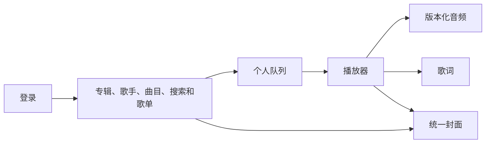

# 产品设计

## 核心概念

| 术语 | 含义 |
|---|---|
| 曲目 | 音乐库中的一条可播放记录，对应一个音频文件，使用 Navidrome 曲目 ID |
| 专辑 | 一组曲目及其专辑信息，使用 Navidrome 专辑 ID |
| 歌手 | 参与曲目或专辑的音乐人，使用歌手 ID 与角色关联 |
| 封面引用 | 对象与图片版本组成的 `coverArtId`，如 `al-AlbumID_0123456789abcdef` |
| 图片版本 | Navidrome 已有的图片内容标识，相同图片内容使用同一版本 |
| 文件版本 | 音频文件的 `updatedAt`，包含小数秒与时区 |
| 输出规格 | 封面的尺寸与裁剪方式，或音频的格式、码率与起始位置 |
| 播放队列 | 有顺序的曲目列表及当前播放位置 |
| 元数据覆写 | 后续由管理员选定、优先于扫描值的字段值 |
| 一起听房间 | 后续全站唯一的共享播放队列与播放状态 |

## 当前入口与登录

音乐站入口为 `/music/`，管理入口为 `/app/`，根地址跳转音乐站。首次在管理界面创建管理员，随后在音乐站使用同一账号登录。

音乐站预设当前站点的 Navidrome 服务。用户主要操作账号和播放器设置，曲目、专辑、歌手、歌单与收藏归属本站音乐库。用户管理和音乐库管理由管理界面承担。

## 浏览、队列与播放

用户从专辑、歌手、曲目列表、搜索结果或歌单选择音乐，播放操作进入个人播放队列。音乐站复用 Feishin 的浏览页面、Web 播放器、队列与歌词交互。

前端页面使用 `/music/#/…` 路由，页面切换保留播放器与个人队列。曲目数据包含曲目 ID、所属专辑、歌手关联、时长、音频格式、文件版本和封面引用；同一份归一化数据供列表、详情、队列和播放栏使用。

多歌手信息来自 `participants`。`artist` 表示曲目歌手，`albumartist` 表示专辑歌手，其他角色继续保留；每位歌手保存独立 ID 与名称，相关入口使用歌手关联跳转。

选择音质后，播放器先使用现有播放决策。可直接播放的音频采用原始文件；基本格式转换使用选定的格式和码率；专用转码继续通过已有兼容接口播放。调整进度时，已缓冲内容直接定位，原始文件的其他区间通过 Range 请求读取。

## 收藏与动态状态

收藏、取消收藏和播放记录沿用 Navidrome 的用户数据与接口。用户在列表、详情或播放器操作收藏后，界面通过现有查询更新读取当前状态。动态响应采用 `no-store`，每次查询对应当前用户与音乐库状态。

当前收藏用于个人音乐管理。公开人数、用户列表、评论与互动按后续设计推进。

## 曲目与专辑共用封面

专辑页、曲目行、播放队列和播放栏使用后端返回的封面引用。曲目与所属专辑使用相同图片内容时，封面引用统一为 `al-{专辑ID}_{图片版本}`；图片内容不同的独立曲目封面使用 `mf-{曲目ID}_{图片版本}`。

| 场景 | 显示与请求 |
|---|---|
| 曲目与专辑的图片内容相同 | 同尺寸、同裁剪方式使用完全相同的 `al-` 媒体地址 |
| 曲目有独立封面 | 使用该曲目的 `mf-` 地址，列表和播放器显示独立图片 |
| 曲目继承专辑封面 | 使用所属专辑的封面引用 |
| 专辑存在分碟封面 | 沿用 Navidrome 的分碟封面选择 |
| 图片正在处理 | 显示现有占位或可读取图片，数据更新后取得带图片版本的引用 |
| 已保存队列保留了 `mf-` 地址 | 相同图片的媒体请求通过 `307` 转到对应的 `al-` 地址 |

封面尺寸是输出规格的一部分：`300/fit` 与 `600/fit` 对应不同显示需求，`fit` 保持比例，`square` 采用方形裁剪。内容与规格相同的页面共用同一媒体地址。

## 媒体更新与缓存体验

| 媒体 | 路径内容 | 更新方式 |
|---|---|---|
| 封面 | 封面引用、尺寸、裁剪方式 | 图片内容变化后更新图片版本 |
| 音频 | 曲目 ID、文件版本、格式、码率、起始位置 | 文件更新并完成扫描后更新文件版本 |

已确认版本的封面和原始音频使用浏览器私有长期缓存。重复访问同一媒体 URL 时，可以直接从内存或磁盘缓存读取。可变封面通过 `ETag` 确认内容，匹配时返回 `304`。图片占位、动态数据和转码采用即时响应。

更换封面或更新音频并完成音乐库处理后，数据接口提供新的媒体引用，页面使用新路径。请求的明确版本已更新时，媒体接口返回 `410`，随后从数据接口取得当前版本。

页面入口、运行配置与 Service Worker 随访问更新，带构建版本的应用资源长期缓存。当前 PWA 提供应用安装与页面资源缓存，手机离线音频管理按后续设计推进。

## 后续功能设计

以下功能按分阶段待办开发。

## 元数据整理

管理员从曲目、专辑或歌手详情进入编辑，修改名称、歌手关联、简介、封面和歌词。选择“一键匹配”后，在本站预览候选结果，按字段选择并应用。

| 数据 | 主要内容 |
|---|---|
| 扫描元数据 | 文件标签、文件位置、音频参数和扫描得到的关联 |
| 元数据覆写 | 对象类型、对象 ID、已选字段及字段值、编辑时间 |
| 封面资源 | 对象关联、图片版本和本地图片位置 |
| 匹配候选 | 来源、候选标识、曲目信息、封面和歌词预览 |

最终展示结果由扫描元数据与元数据覆写合成。重新扫描更新文件信息，已编辑字段继续使用元数据覆写。管理员可按字段恢复扫描值。曲目与专辑的歌手关联采用同一数据结构，搜索、详情和兼容接口读取一致结果。

元数据整理以数据库编辑为主。外部匹配由管理员主动发起，通过选定的 MusicTag 类服务提供候选。音乐库浏览直接读取已保存的信息。Last.fm、MusicBrainz 等现有文件标签保留为元数据，外部信息获取与播放记录上报分别设置。

## 评论与收藏

曲目、专辑和歌手详情提供评论。曲目播放页提供歌词与评论切换，评论可附带播放时间，点击时间可跳转到对应位置。

| 数据 | 主要内容 |
|---|---|
| 评论 | 对象类型、对象 ID、作者、正文、回复对象、可选播放时间、发布时间 |
| 评论点赞 | 评论 ID 与用户 ID，一位用户对同一评论保留一个点赞状态 |
| 收藏 | 复用 Navidrome 的曲目、专辑与歌手收藏关系 |
| 收藏可见性 | 私密、公开人数、公开列表 |

公开人数统计允许公开计数的收藏，用户列表展示允许公开身份的收藏。个人设置同时决定本人收藏在人数、列表和个人资料中的展示。回复沿用所属讨论对象，删除评论时保留已有回复的阅读关系。

## 一起听

用户从“一起听”入口查看当前曲目、队列和在线成员，选择加入后跟随房间播放，离开后回到个人播放队列。首次加入通过用户操作启动声音。

房间采用主持人控制播放、全员添加曲目的规则。主持人负责播放、暂停、切歌、进度与队列排序；主持人离开后，由在线时间最早的成员接任。

房间状态包含队列、当前队列项、播放状态、基准进度、服务端更新时间、状态序号和主持人。队列项使用独立 ID，同一曲目可以重复加入。成员以用户 ID 聚合，设备连接属于成员。

服务端确定房间状态与切歌时机。客户端根据服务端时间估算目标进度，通过定期校时调整播放；较小偏差保持播放，持续偏差逐步校正，明显偏差跳转到目标位置。重连先读取完整房间状态，再继续接收更新。进程重启后房间回到空闲状态。

## 手机离线音乐

用户在曲目或专辑操作中选择“下载到本机”，在“离线音乐”查看下载进度、占用空间与可用曲目，支持取消和删除。完成下载的曲目可在断网后浏览、加入队列和播放。

Cache Storage 保存应用页面、封面与离线展示数据；OPFS 保存完整音频；离线目录保存曲目 ID、媒体版本、音质、本地文件位置、大小与完成状态。下载完成后曲目才进入可播放列表。播放器使用本地音频地址，继续支持进度调整。

离线音乐按本站账号管理。退出时提供清理本机音乐的选择。空间不足时展示已用空间并由用户选择删除；浏览器提供的实际存储能力决定设备可使用的离线功能。

## 中心站对接

ServerMan 通过 OIDC 提供中心身份，音乐站保存中心身份与 Navidrome 用户 ID 的绑定。音乐库、收藏、歌单和播放记录继续归属音乐站。后续在现有账号上完成绑定，保留用户已有音乐数据。

